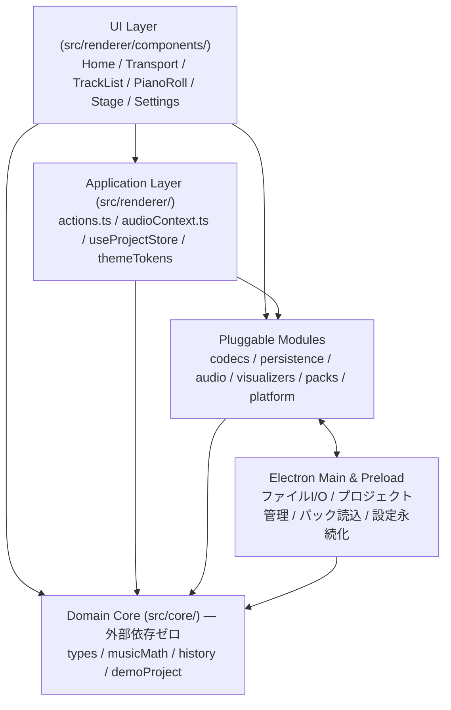

# アーキテクチャ & 拡張ガイド

Tone Bone は **「外側の UI・Electron ほど薄く、内側の純粋ドメインほど依存ゼロ」** となる疎結合モジュール構造を採用しています。保存形式・音源・書き出し形式・Stage Mode の演出・OS I/O はすべてインターフェースで分離されており、既存コードをほとんど触らずに差し替え・拡張できます。

---

## レイヤー構成と依存方向

### ディレクトリと責務

| ディレクトリ | 責務 | 主なファイル |
| :--- | :--- | :--- |
| `src/core/` | 音楽ドメイン型・トラック種別仕様・時間計算・編集ロジック・Undo/Redo（React / Electron / Web Audio 非依存） | `types.ts`, `trackTypes.ts`, `musicMath.ts`, `history.ts`, `demoProject.ts` |
| `src/codecs/` | プロジェクトの保存・読込フォーマット抽象（差し替え可能） | `types.ts`, `CodecRegistry.ts`, `SimpleJsonV1Codec.ts` |
| `src/persistence/` | 保存方式（自動保存 / 手動保存）の差し替え可能な戦略モジュール | `types.ts`, `SaveStrategyRegistry.ts`, `DebouncedAutoSaveStrategy.ts`, `ManualSaveStrategy.ts` |
| `src/packs/` | テーマパック／音源パックの独立優先順位マージ・表示順変換・CSS 動的適用 | `packMerger.ts`, `packOrder.ts`, `themeApplier.ts` |
| `src/audio/` | `BaseAudioContext` 共通設計の音源・レジストリ・単調増加スケジューラ・音声書き出し | `scheduler.ts`, `AudioEngine.ts`, `VoiceRegistry.ts`, `AudioExporterRegistry.ts`, `voices/`, `exporters/` |
| `src/visualizers/` | Stage Mode 描画プラグイン（差し替え可能） | `types.ts`, `VisualizerRegistry.ts`, `MinimalFlowRenderer.ts`, `canvasUtils.ts` |
| `src/platform/` | OS/ファイルI/O 抽象インターフェース・共有型安全 IPC 契約（Electron / インメモリ実装） | `types.ts`, `ipcContract.ts`, `ElectronPlatformAdapter.ts`, `MemoryPlatformAdapter.ts` |
| `src/main/` & `src/preload/` | Electron Main プロセス・自動生成 IPC ブリッジ・機能別 IPC ハンドラ・永続化リポジトリ | `main/index.ts`, `main/ipc/`, `projectRepository.ts`, `settingsRepository.ts`, `packRepository.ts`, `preload/index.ts` |
| `src/renderer/` | 薄い React UI・アプリ操作窓口・スライス分割された状態ストア | `actions.ts`, `audioContext.ts`, `themeTokens.ts`, `store/useProjectStore.ts`, `store/slices/`, `components/` |

---

## コア設計のポイント

### 1. 時間解像度（`PPQN = 480`）と三連符
- 1拍（4分音符）= `480 ticks`、4/4 拍子の 1小節 = `1920 ticks`。
- `1920` は `4, 8, 16, 32` だけでなく三連符の `6, 12, 24` でも割り切れるため、通常音符と三連符が混在しても浮動小数点誤差が発生しません。

### 2. 単調増加 Tick（Monotonic Absolute Tick）スケジューラ
- `src/audio/scheduler.ts` の `collectScheduledNotes()` と `AudioEngine` は、再生中の内部時間を折り返さず単調増加させます。
- UI 表示用の再生ヘッド位置（`getCurrentTick()`）のみ `% totalTicks` で折り返すことで、ループ境界を跨ぐ先読み窓での重複発音や欠落を構造的に防いでいます。

### 3. ピアノロールの4層分離とビューポート仮想化
- `pianoRollGeometry.ts`：座標変換・可視範囲カリング・ノーツ当たり判定（純粋 TS・単体テスト対象）
- `pianoRollInteraction.ts` / `usePianoRollInteraction.ts`：ポインタ状態機械（作成・伸縮・移動・範囲選択）とツール定義（純粋 TS・単体テスト対象）
- `pianoRollRenderer.ts`：画面内に見えている範囲のみを描画する仮想化 Canvas レンダラー
- `PianoRoll.tsx`：スクロールスペーサー＋画面サイズ固定の Sticky Canvas とフッター UI
- この構成により、4小節でも 999小節でも Canvas のピクセル数と描画コストは一定です。

---

## 各モジュールの拡張・差し替え方法

### 保存形式を追加・差し替える（`ProjectCodec`）
1. `src/codecs/` に `ProjectCodec`（`id`, `label`, `extensions`, `canDecode`, `encode`, `decode`）を実装したクラスを追加します。
2. `src/codecs/CodecRegistry.ts` の `createDefaultCodecRegistry()` で `registry.register(new MyCodec(), true)` のように登録します（第2引数 `true` でデフォルト保存形式を差し替え可能。旧形式も登録したままなら `decodeAuto()` で自動判別して開けます）。
3. 保存時の初期拡張子・ファイル選択ダイアログのフィルタ・ワークスペース一覧／作成／リネームはすべて `CodecRegistry`（`getDefaultExtension` / `getAllExtensions` / `getFileFilters`）から自動導出されるため、UI・ストア・Main の変更は不要です。

### 保存方式を追加・差し替える（`SaveStrategy`）
1. `src/persistence/` に `SaveStrategy`（`id`, `label`, `onProjectChanged`, `prepareLeave`, `dispose`）を実装したクラスを追加します（例：世代バックアップ付き保存やクラウド同期など）。
2. `src/persistence/SaveStrategyRegistry.ts` の `createDefaultSaveStrategyRegistry()` に登録します（設定画面の「エディタ → プロジェクトの保存方式」から切替可能）。

### ビジュアライザー演出を追加する（`VisualizerRenderer`）
1. `src/visualizers/` に `VisualizerRenderer`（`id`, `name`, `render(ctx, frame, preset)`）を実装します。
2. `src/visualizers/VisualizerRegistry.ts` の `createDefaultVisualizerRegistry()` に登録し、テーマパックの `visualizer.json` で `"rendererId": "<登録したID>"` を指定すれば切り替えられます。

### 音源ボイスを追加・差し替える（`AudioVoice`）
1. `src/audio/voices/` に `AudioVoice`（`type`, `trigger(params)`）を実装したクラスを追加します。
2. `src/audio/VoiceRegistry.ts` の `createDefaultVoiceRegistry()` に登録すると、リアルタイム再生（`AudioEngine`）とオフライン書き出し（`WavExporter` 等）の両方で自動的に利用されます。

### 音声書き出し形式を追加する（`AudioExporter`）
1. `src/audio/exporters/` に `AudioExporter`（`id`, `label`, `extension`, `export(project, instruments) => Promise<Uint8Array>`）を実装します。
2. `src/audio/AudioExporterRegistry.ts` の `createDefaultAudioExporterRegistry()` に登録します。
3. 書き出し処理は `src/renderer/actions.ts` の `exportCurrentProject(exporterId)` と汎用 IPC（`audio:saveExport` / `PlatformAdapter.saveExportFile`）を経由するため、Main プロセスや Preload を修正せずに新形式を書き出せます。`SynthVoice` / `DrumVoice` は `BaseAudioContext` 対応のため、`OfflineAudioContext` でリアルタイム再生と完全に同じ音色・バランスをオフラインレンダリングできます。

### 設定タブを追加する
1. `src/renderer/components/settings/` に新しいタブコンポーネントを作成します。
2. `src/renderer/components/SettingsModal.tsx` の `SETTINGS_TABS` 配列に 1 エントリ追加するだけでタブ切替と描画が自動で反映されます。

### キーボードショートカットを追加・変更する
- `src/renderer/shortcuts.ts` の `SHORTCUT_BINDINGS` 宣言テーブルにエントリを追加・変更します（`App.tsx` のイベントリスナ変更は不要）。
